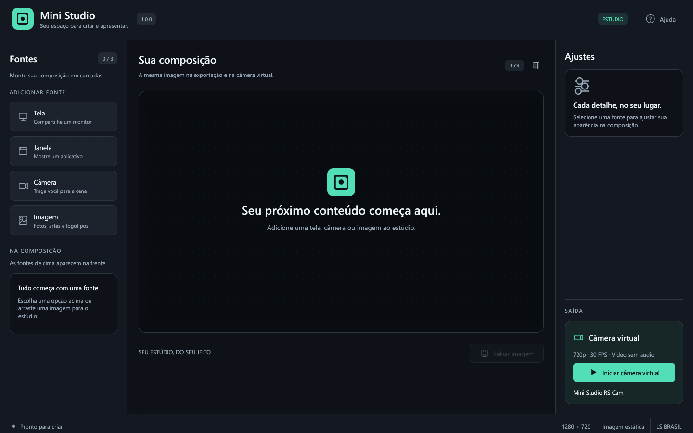

# Mini Studio 1.0.0

Seu espaço para criar e apresentar. Um estúdio nativo para Windows que combina tela, janela, câmera, canais NDI e imagem, com prévia ao vivo, exportação PNG e câmera virtual.



## Instalar e começar

Abra **`dist/MiniStudio-1.0.0-Setup.msi`**. O instalador em português cria os atalhos, instala o aplicativo e configura a câmera virtual no Windows 11. A instalação pede administrador; o aplicativo roda normalmente, sem elevação.

Também há **`dist/MiniStudio-1.0.0-portable.zip`**: extraia e abra `mini-studio-rs.exe`. A câmera virtual exige o componente instalado pelo MSI. Os hashes dos pacotes ficam em `dist/SHA256SUMS-1.0.0.txt`.

1. No rodapé, use **+** em **Cenas**, dê um nome e crie a cena. Novas cenas começam vazias, prontas para receber fontes da biblioteca.
2. No lado esquerdo do rodapé, use **+** para escolher o tipo de fonte. A engrenagem abre um editor amplo na área principal; **Voltar à prévia** retorna à composição. Arraste uma fonte sobre uma cena no painel à direita para adicioná-la. Você pode usar a mesma fonte em várias cenas.
3. Arraste qualquer fonte na prévia para posicioná-la; use as oito alças dos cantos e laterais para redimensionar. A lista mostra as fontes da frente para trás; use **↑ / ↓** para mudar a ordem.
4. O olho mostra ou oculta e o cadeado bloqueia o movimento na prévia. **Propriedades** (ou dois cliques na fonte) abre nome, arquivo/dispositivo, espelhamento e opacidade. Posição, tamanho e recorte são ajustados diretamente na prévia.
5. Em **Controles**, salve a cena, exporte uma imagem PNG ou inicie a câmera virtual. No aplicativo consumidor, escolha **Mini Studio RS Cam**.

O [guia do usuário](docs/Guia-do-usuario.txt) acompanha os pacotes da versão 1.0; o fluxo de cenas descrito abaixo corresponde ao código atual do projeto. **Ajuda** ou **F1** abre orientações e opções de tamanho da interface.

## Cenas e fontes

A prévia ocupa a parte superior. No rodapé redimensionável, **Fontes** fica à esquerda; **Cenas**, **Fontes da cena** e **Controles** ficam à direita. Arraste uma fonte cadastrada sobre uma cena para adicioná-la. As propriedades abrem em um diálogo, sem ocupar as laterais.

Cada cena guarda uma lista ordenada de usos das fontes da biblioteca, com visibilidade, bloqueio e transformação independentes. O nome e a captura são compartilhados. Não existe mais a restrição de uma fonte por tipo: uma cena pode misturar várias imagens, telas, janelas e câmeras.

- Clique em uma cena para alternar. A câmera virtual continua ligada, se estiver ativa.
- **Visualização múltipla**, no painel **Controles**, abre uma segunda janela redimensionável com prévias ao vivo de todas as cenas. Clique uma vez em qualquer miniatura para trocar a cena da saída; a cena ativa fica destacada. A grade acompanha novas cenas e alterações de composição. Enquanto aberta, mantém as fontes das cenas ativas e compartilha capturas iguais; ao fechar, libera as capturas extras de tela e imagem.
- **Projetor de saída**, em **Controles**, exibe a cena ativa em uma janela própria ou em tela cheia no monitor escolhido. A imagem acompanha as trocas e edições de cena, com a mesma ordem, recorte, espelhamento e opacidade da prévia, sem guias, seleção ou mensagens do editor. A proporção 16:9 é preservada com faixas pretas. Funciona sem iniciar a câmera virtual. No projetor, **F11** alterna tela cheia e **Esc** fecha; o botão direito oferece essas ações. Também é possível usar **Fechar projetor** nos Controles. Se o monitor escolhido for desconectado ou reconfigurado, a projeção fecha e o aplicativo avisa para escolher o destino novamente.
- As alterações das cenas são salvas automaticamente e ao fechar o aplicativo. **Ctrl+S** permite gravar imediatamente. **Salvar imagem** exporta PNG.
- No menu **•••** de Cenas, renomeie ou duplique. A lixeira exclui a cena selecionada; a última cena é mantida.
- Para repetir uma fonte na composição, selecione-a e use **+ → Duplicar fonte selecionada** ou **Ctrl+D**. As duas camadas têm ajustes independentes e compartilham a captura do dispositivo.
- Ao reabrir o aplicativo ou trocar de cena, as fontes da cena ativa iniciam automaticamente. Se uma origem falhar, o aplicativo faz novas buscas e recria a captura automaticamente, com intervalos entre 2 e 5 segundos após cada falha. É possível substituir a origem, mantendo o enquadramento. As propriedades continuam disponíveis para nome, espelhamento e opacidade.

As cenas ficam em `%LOCALAPPDATA%\MiniStudioRS\scenes.json`. A estrutura anterior é migrada para a lista de fontes, preservando os nomes, referências e visibilidade. Imagens são referenciadas pelo caminho original: mantenha os arquivos nesse local. Janelas selecionadas são acompanhadas pelo identificador, mesmo quando o título muda. Quando uma janela é recriada, a busca usa o título e o aplicativo; se o título também mudou, só usa o aplicativo quando há uma única candidata identificável. Correspondências ambíguas continuam sendo verificadas, sem escolher uma janela ao acaso.

### Biblioteca de fontes (2.0)

Em **Fontes**, à esquerda do rodapé, crie e configure telas, janelas, câmeras, canais NDI e imagens antes de montar as cenas. **Adicionar fonte da biblioteca**, na prévia vazia, ou **+** em Fontes da cena reutiliza uma fonte cadastrada; você pode adicioná-la várias vezes e em várias cenas. Fontes sem uso ficam disponíveis sem iniciar uma captura.

O nome e a configuração de captura são compartilhados. Posição, tamanho, recorte, espelhamento, opacidade, visibilidade, bloqueio e ordem pertencem a cada uso na cena. Duplicar uma fonte ou cena mantém os vínculos; **Criar cópia independente**, na biblioteca, cria outra configuração.

Remover uma camada ou excluir uma cena mantém a fonte na biblioteca. A exclusão da biblioteca fica disponível após remover seus usos. As cenas antigas são migradas automaticamente, preservando seus layouts e criando uma entrada independente para cada fonte antiga, mesmo quando usam o mesmo dispositivo ou arquivo. O arquivo migrado usa o formato 3 e não deve ser aberto em versões anteriores do aplicativo.

## Receber canais NDI

No código atual, **+ em Fontes → NDI** (ou **NDI** na prévia vazia) procura transmissores no computador e na rede local. Instale o [NDI Runtime 6 para Windows x64](https://ndi.link/NDIRedistV6), abra o transmissor e selecione o canal. O botão **Atualizar lista** repete a busca; anúncios da rede podem levar alguns segundos. Sem o runtime, os demais tipos de fonte continuam funcionando.

O canal passa a ser uma camada normal: pode ser recortado, espelhado, duplicado, sobreposto e usado na prévia, no projetor, no PNG e na câmera virtual. **Propriedades → Escolher outra fonte** permite escolher outro canal preservando o enquadramento. A cena salva o nome completo do canal; a recepção inicia automaticamente ao reabrir a cena.

Se o vídeo parar por três segundos, a imagem antiga é removida e aparece **Aguardando NDI…**. A recepção volta automaticamente quando o mesmo canal reaparece. Confira o transmissor, a rede e as permissões de firewall se a lista estiver vazia. O NDI Access Manager pode configurar descoberta entre sub-redes.

A integração recebe **somente vídeo**, até 16.777.216 pixels e 8192 pixels por lado. Áudio, PTZ, tally e envio NDI não estão implementados. A geometria atual presume pixels quadrados; sinais anamórficos precisam de ajuste manual do enquadramento. A recepção NDI HX depende do suporte do runtime e do emissor e ainda não foi validada aqui. O runtime é instalado separadamente e não é incluído nos pacotes do Mini Studio. Os pacotes 1.0 já existentes em `dist` não são atualizados apenas por alterar o código.

Referências e validação da implementação: [integração NDI](docs/ndi.md).

## Enquadramento com o mouse

- Selecione a fonte na prévia ou na lista. As oito alças redimensionam preservando a proporção atual; segure **Shift** para alterar largura e altura livremente.
- Segure **Alt** e arraste uma alça para recortar. Arraste de volta para recuperar a parte escondida; o arquivo original permanece intacto. Fontes recortadas têm contorno verde.
- Ao mover, a fonte encaixa nas bordas e centros da tela e das outras fontes visíveis. Segure **Ctrl** para mover sem encaixe. As linhas azuis indicam alinhamentos; as medidas mostram as distâncias até as bordas em pixels da saída 1280 × 720.
- É possível mover e ampliar uma fonte além da tela; a saída mostra apenas a parte dentro dela.
- O **botão direito** abre ações para ajustar à tela, centralizar, espelhar e restaurar o enquadramento. O diálogo de Propriedades mantém os ajustes de nome, arquivo/dispositivo, espelhamento e opacidade; use o mouse na prévia para posição, tamanho e recorte.
- **Ctrl+Z / Ctrl+Y** desfazem/refazem os gestos da prévia e as ações do menu de enquadramento na cena atual. **Esc**, durante um arraste, cancela o gesto. O cadeado impede gestos e movimentos pelo teclado.

Posição, tamanho, recorte e espelhamento são salvos com cada fonte e aplicados à prévia, ao PNG e à câmera virtual. As alças e medidas aparecem somente no editor.

## Recursos

- Interface escura com tipografia do Windows, ícones vetoriais, controles acessíveis por teclado e painéis que se adaptam a janelas menores.
- Composição de múltiplas telas, janelas, câmeras e imagens em 1280 × 720.
- Captura do ponteiro do mouse configurável por fonte de tela ou janela em **Propriedades → Capturar ponteiro do mouse** (Ctrl+E), com aplicação imediata e escolha salva na cena.
- Ordem livre das camadas, transparência PNG, opacidade, posição, tamanho, espelhamento e bloqueio por fonte.
- Prévia, PNG e câmera virtual compartilham a mesma ordem e geometria das fontes. Guias e seleção aparecem somente no editor.
- Saída virtual NV12 a 30 FPS, com início e parada independentes das fontes e indicação de atividade.
- PNG/JPEG por seletor, arrastar e soltar ou `--image "C:\imagens\arte.png"`; leitura em segundo plano e preservação da imagem anterior em caso de erro.
- Busca no seletor de dispositivos/janelas, atualização da lista, estados de carregamento e mensagens de erro.
- Cenas e preferências salvas por usuário. As fontes da cena ativa iniciam automaticamente ao reabrir o aplicativo.

| Atalho               | Ação                                       |
| -------------------- | ------------------------------------------ |
| Ctrl+O               | Abrir imagem                               |
| Ctrl+S               | Salvar cena                                |
| Ctrl+Shift+S         | Exportar composição PNG                    |
| Ctrl+D               | Duplicar fonte selecionada                 |
| Ctrl+E               | Propriedades da fonte                      |
| Ctrl+F               | Ajustar fonte à tela                       |
| Ctrl+Z / Ctrl+Y      | Desfazer / refazer enquadramento na prévia |
| Setas / Shift+setas  | Mover fonte 1 / 10 pixels                  |
| Del                  | Remover fonte selecionada                  |
| F1                   | Ajuda e escala da interface                |
| Esc                  | Fechar diálogo ou desmarcar fonte          |
| Tab / Enter / Espaço | Navegar e ativar controles                 |

Áudio, gravação de vídeo e transmissão pela internet não estão disponíveis. Imagens aceitam até 32 MiB, 16 milhões de pixels e 8192 pixels por lado. A saída é fixa em 720p.

## Requisitos e funcionamento

**Aplicativo:** Windows 10 1903/build 18362 ou superior, x64, com GPU/driver Direct3D 12. **Câmera virtual:** Windows 11 build 22000 ou superior ([requisito da Microsoft](https://learn.microsoft.com/en-us/windows/win32/api/mfvirtualcamera/nf-mfvirtualcamera-mfcreatevirtualcamera)).

A captura utiliza Windows Graphics Capture; a câmera utiliza Media Foundation. Interface Rust/egui/eframe, GPU via wgpu/Direct3D 12. Não requer Node.js, WebView2 ou .NET no computador do usuário.

Prévia parada pode indicar conteúdo estático: o contador mede quadros **novos**. A saída virtual possui relógio próprio e continua enviando a composição. Capture outra tela ou uma janela específica para evitar a repetição da própria prévia. Janelas minimizadas e conteúdo protegido podem interromper a captura.

A câmera virtual usa registro COM próprio e `%ProgramData%\MiniStudioRS\vcam-frames.bin`. Apenas um produtor publica por vez. No MSI, o usuário que cria o arquivo, administradores e o serviço de câmera recebem acesso; em computadores compartilhados, consulte o guia para trocar o produtor. Preferências ficam em `%LOCALAPPDATA%\MiniStudioRS\preferences.json`.

Para atualizar ou desinstalar, feche o aplicativo e seus consumidores. Use o MSI da nova versão ou **Configurações → Aplicativos → Mini Studio**. Se o Windows mantiver o componente em uso, reinicie antes de tentar novamente.

## Desenvolvimento e distribuição

Requisitos de desenvolvimento: Rust MSVC, Visual Studio Build Tools C++, Windows SDK, CMake. O empacotamento também usa Python 3 e .NET SDK para executar WiX 5.0.2; essas ferramentas não são dependências do aplicativo distribuído.

```powershell
cargo run
cargo fmt -- --check
cargo test
cargo clippy --all-targets -- -D warnings
cargo build --release
.\scripts\build-vcam.ps1
.\scripts\release.ps1
```

`release.ps1` verifica formatação, testes e Clippy, compila o aplicativo e o componente nativo, reúne os avisos de terceiros e gera MSI, ZIP e SHA-256 em `dist`. A versão vem do campo `version` do `package.json` e é incorporada ao EXE, à DLL e ao instalador. Para uma nova versão, altere apenas esse campo e recompile. Use `major.minor.patch`, com limites de 255.255.65535 para o MSI. A versão declarada no `Cargo.toml` é apenas metadado do pacote Rust. `-SkipBuild` reutiliza binários já compilados, conferindo suas versões. `package.json` também contém atalhos opcionais para esses comandos.

Para desenvolvimento do componente, `scripts/install-vcam.ps1` e `scripts/uninstall-vcam.ps1` continuam disponíveis e exigem PowerShell como administrador. Para usuários finais, use o MSI. Não misture os dois mecanismos de instalação/remoção.

## Validação

Há testes da composição, transparência, imagens inválidas, conversão NV12, preferências, interação da interface e transporte concorrente. Testes de dispositivos reais são opt-in:

```powershell
cargo test installed_virtual_camera_round_trip -- --ignored --nocapture
cargo test installed_virtual_camera_ffmpeg -- --ignored --nocapture
cargo test benchmark_real_monitor_stream -- --ignored --nocapture
cargo test installed_ndi_video_round_trip -- --ignored --nocapture
```

O primeiro exige o componente instalado; o segundo também exige FFmpeg no PATH. Para o teste contínuo, defina `$env:MINISTUDIO_VCAM_TEST_SECONDS='600'` antes de executar o primeiro comando.

O teste NDI exige o runtime x64 e anuncia um canal de vídeo sintético na rede local. Verifica descoberta, cores/transparência, troca de resolução, perda de sinal, reconexão e encerramento.

Resultados e limites: [validação da 1.0](docs/validacao-1.0.0.md), [desempenho](docs/desempenho.md) e [arquitetura de imagens/câmera virtual](docs/imagens-e-camera-virtual.md). As [decisões do MVP](docs/mvp.md) são somente histórico.
